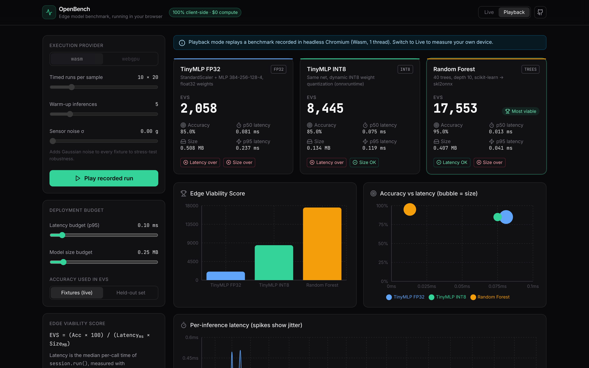

# OpenBench

**Benchmark quantized edge ML models in your browser. No backend, no GPU, no API keys, $0.**

OpenBench is an evaluation playground and latency profiler for tiny models headed to edge and IoT hardware. It loads three ONNX models into [onnxruntime-web](https://onnxruntime.ai/docs/tutorials/web/), runs them on real-shaped accelerometer windows from a road-hazard detection task, times every `session.run()` with `performance.now()`, and ranks them with a live **Edge Viability Score**.

**Live demo:** https://sohamkhrt.github.io/openbench/



## Why

Models that look fine in a notebook often fail on edge devices: latency spikes, memory pressure and binary size are invisible until deployment. OpenBench makes the trade-off between **accuracy, latency, size and quantization** visible in one screen, on the device you are holding, so you can pick a model before you flash firmware.

## Features

- **In-browser inference** with onnxruntime-web (WebAssembly SIMD, single thread to mimic one edge core). An optional WebGPU provider falls back to Wasm, with a visible notice, for operators it has no kernels for.
- **Honest timing.** Warm-up passes, then per-call latency from calibrated batches of back-to-back calls, because browsers round `performance.now()` to about 0.1 ms. Mean, p50, p95, max, σ and session load time are reported.
- **Edge Viability Score**, recomputed live:

  $$\text{EVS} = \frac{\text{Accuracy} \times 100}{\text{Latency (ms)} \times \text{Size (MB)}}$$

  Latency is the p50 per-call time. Accuracy can come from the live fixtures or the held-out test set.
- **Interactive sliders:** timed runs, warm-up count, injected sensor noise (robustness test), and a deployment budget for p95 latency and model size with pass/fail badges.
- **Charts** (Recharts): EVS leaderboard, accuracy vs latency bubble chart (bubble = size), per-inference latency timeline with the budget line, and a 3-axis signal inspector showing each model's prediction and confidence.
- **Static playback fallback.** If live inference fails for any reason, the app replays a recorded benchmark (`public/playback.json`) with the same UI, so a demo never shows an error. Playback can also be chosen manually.
- **Export** any run as JSON.

## The models

| Model | What it is | Size | Held-out acc. |
|---|---|---|---|
| TinyMLP FP32 | StandardScaler + MLP (384-256-128-4), float32 | 0.51 MB | 87.0% |
| TinyMLP INT8 | Same network, dynamic INT8 weight quantization | 0.13 MB | 87.0% |
| Random Forest | 40 trees, depth 10, scikit-learn exported with skl2onnx | 0.41 MB | 96.3% |

Held-out accuracy is on 1,000 windows not used in training. The INT8 model is 3.8x smaller than FP32 with no accuracy loss, and a classic tree ensemble beats both on raw windows, which is exactly the kind of result OpenBench is built to surface.

Sample results (headless Chromium, Wasm, 1 thread):

| Model | p50 latency | p95 latency | EVS |
|---|---|---|---|
| TinyMLP FP32 | 0.081 ms | 0.237 ms | 2,058 |
| TinyMLP INT8 | 0.075 ms | 0.119 ms | 8,445 |
| Random Forest | 0.013 ms | 0.041 ms | 17,553 |

Your numbers will differ by device. That is the point.

## The data

Each sample is a 1.28 s window of a 3-axis accelerometer at 100 Hz (384 values, units of g) from a vehicle-mounted sensor, labelled `smooth`, `rough`, `pothole` or `speed_bump`.

The data is **physically modelled, not recorded**: `training/train.py` simulates gravity, engine vibration, 1/f road texture, pothole impacts with wheel-hop and suspension responses, and speed bumps with front and rear axle passes at random speeds. This keeps the repository self-contained and license-free. To use a recorded dataset instead (for example the PVS Passive Vehicular Sensors dataset), replace `make()` in the training script with a loader that returns the same `(N, 384)` layout and re-run it.

`public/fixtures/road_vibration.json` holds the 20 fixtures (5 per class) used by the browser.

## Run locally

```bash
npm install
npm run dev          # http://localhost:5173
npm run build        # static site in dist/
```

Retrain the models and regenerate fixtures (Python 3.10+):

```bash
pip install -r training/requirements.txt
npm run train        # writes public/models/*.onnx, manifest.json, fixtures
```

To refresh the playback recording, run a live benchmark, click **Export JSON**, and save the file as `public/playback.json`.

## Deploy ($0)

The repo ships a GitHub Actions workflow (`.github/workflows/deploy.yml`) that builds and publishes to GitHub Pages on every push to `main`. In the repository, open **Settings → Pages** and set **Source** to **GitHub Actions** once. The build uses relative paths, so it works under any sub-path. Any static host (Vercel, Netlify, Cloudflare Pages) also works with `npm run build` and `dist/` as the output.

## How it works

```
fixtures JSON ──► Float32Array (+ optional noise)
                        │
manifest.json ──► ort.InferenceSession.create(model.onnx, { executionProviders: [wasm|webgpu] })
                        │
                warm-up runs ─► calibrate batch size (≥ 2 ms per timing)
                        │
     for each run, for each fixture: t0 = performance.now(); session.run() × k; dt / k
                        │
       accuracy, mean/p50/p95/max/σ, load time ─► EVS ─► charts, budgets, export
```

Key files: `src/lib/bench.ts` (inference and timing), `src/App.tsx` (dashboard), `src/components/Charts.tsx`, `training/train.py`.

## Stack

React 19, Vite, TypeScript, Tailwind CSS, Lucide icons, Recharts, onnxruntime-web, scikit-learn, skl2onnx, onnxruntime quantization. Everything is free and open source; nothing runs on a server.

## Limitations

- Browser timing includes JavaScript and Wasm call overhead, so absolute numbers are higher than native C++ on the same chip. Relative comparisons are what matter.
- The dataset is simulated (see above). Accuracy numbers describe the simulation, not real roads.
- WebGL is not offered because it lacks kernels for tree ensembles and integer MatMul.

## License

MIT
