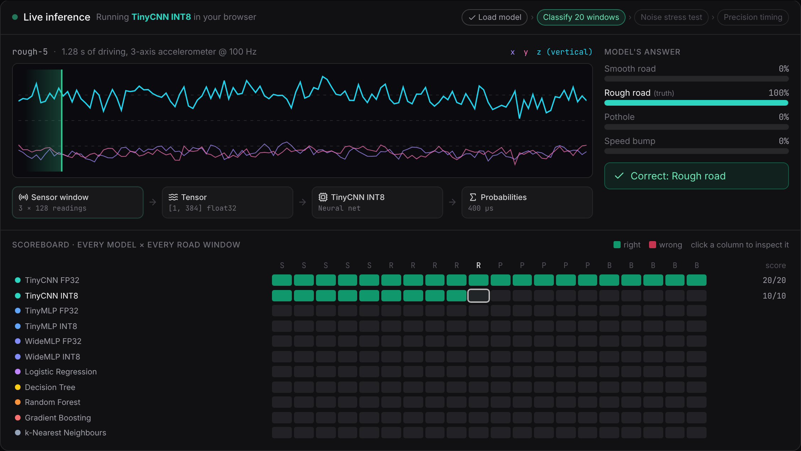
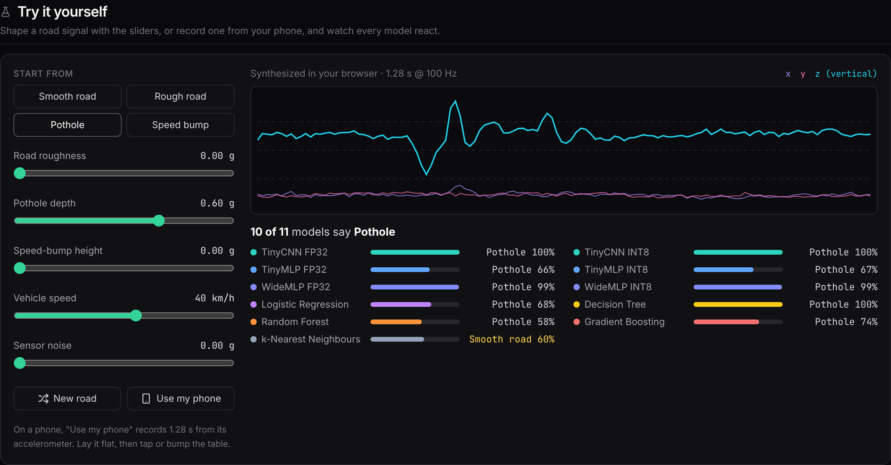
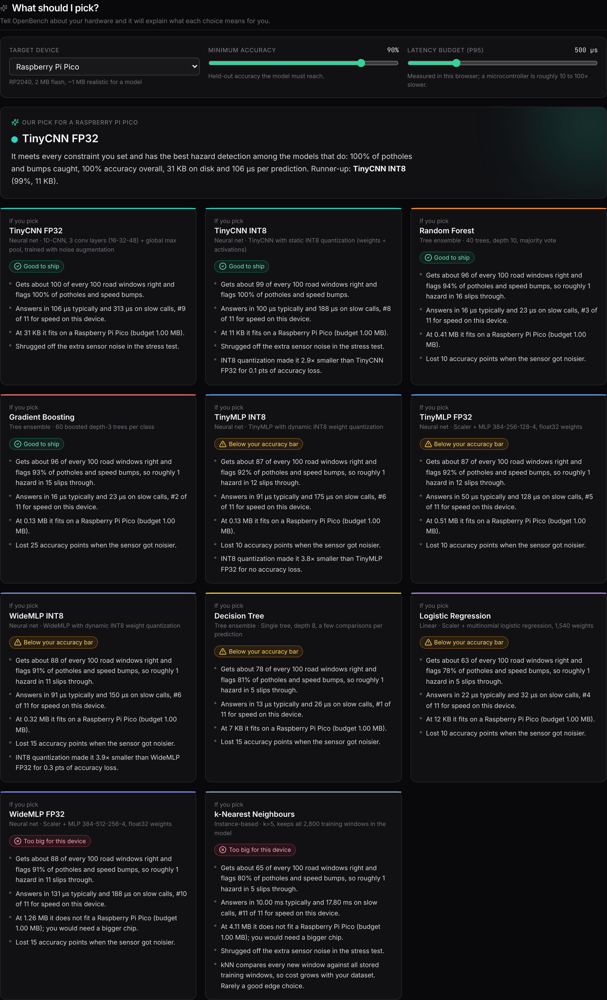

# OpenBench

**Benchmark quantized edge ML models in your browser. No backend, no GPU, no API keys, $0.**

OpenBench is an evaluation playground and latency profiler for tiny models headed to edge and IoT hardware. It loads eleven ONNX models (a 1D-CNN and MLPs in FP32 and INT8, linear, tree ensembles and kNN) into [onnxruntime-web](https://onnxruntime.ai/docs/tutorials/web/), shows each one classifying accelerometer windows from a road-hazard detection task in real time, times every `session.run()` with `performance.now()`, ranks them on 14 metrics including a live **Edge Viability Score**, and recommends one for your target device.

**Live demo:** https://sohamkhrt.github.io/openbench/




## Why

Models that look fine in a notebook often fail on edge devices: latency spikes, memory pressure and binary size are invisible until deployment. OpenBench makes the trade-off between **accuracy, latency, size, robustness and quantization** visible in one page, on the device you are holding, and then tells you in plain English what each choice means for your hardware.

## What you see

1. **Live inference.** Each model reads every 1.28 s accelerometer window while a cursor sweeps the signal, the pipeline (sensor window → tensor → model → probabilities) lights up, class probabilities fill in, and a scoreboard of every model × every window turns green or red. These are real `session.run()` calls, slowed down so you can follow them.
2. **Ranked leaderboard.** 14 metrics in five sections (Overall, Prediction quality, Speed, Footprint, Robustness), each a ranked bar chart with a winner badge, a one-line definition and a "What this means for you" explainer. Toggle models on and off; hatched bars are INT8-quantized.
3. **What should I pick?** Choose a target device (Arduino Nano 33 BLE, Raspberry Pi Pico, ESP32-S3, Pi Zero 2 W, phone), a minimum accuracy and a latency budget. OpenBench recommends a model, names a runner-up, and writes an "If you pick this" card for every model: how many hazards it misses, how fast it is, whether it fits, how it handles noise, and what quantization bought you.
4. **Try it yourself.** A signal lab with sliders for road roughness, pothole depth, bump height, speed and sensor noise. Every model re-classifies the signal as you drag, so you can find the point where each one breaks. On a phone, "Use my phone" records 1.28 s from the real accelerometer instead.
5. **Bring your own model.** Click "Add your .onnx" to benchmark your own model against the built-ins. It needs a float32 input of 384 values (`[1,384]` or `[1,3,128]`) and an output with 4 class scores (logits are fine, softmax is applied). The file never leaves your browser.
6. **Where each model goes wrong.** A confusion matrix per model, with its biggest mistake spelled out.
7. **Trade-offs and raw data.** Accuracy vs latency bubble chart (bubble = size), per-inference latency timeline, full results table and JSON export.





## Metrics

| Section | Metric | Source |
|---|---|---|
| Overall | Edge Viability Score: $\text{EVS} = \frac{\text{Accuracy} \times 100}{\text{Latency (ms)} \times \text{Size (MB)}}$ | live latency × accuracy × file size |
| Quality | Accuracy, hazard recall (potholes + speed bumps caught), macro F1 | 1,000 held-out windows |
| Quality | Live fixture accuracy | the 20 fixtures, in the browser |
| Speed | p50 latency, p95 latency, jitter (p95/p50), throughput | live, `performance.now()` |
| Footprint | File size, parameter count, cold start (load + init) | model file / live |
| Robustness | Accuracy with 0.05 g extra sensor noise, accuracy lost to noise | live |

**Timing method.** Warm-up passes, then per-call latency from calibrated batches of back-to-back calls (each timing spans at least 2 ms), because browsers round `performance.now()` to about 0.1 ms and these models run in microseconds. The Wasm runtime is initialised before the first model so cold start compares models, not the runtime. Single thread, to mimic one edge core and to work on static hosting without cross-origin isolation.

## The models

| Model | What it is | Size | Held-out acc. | Hazard recall |
|---|---|---|---|---|
| TinyCNN FP32 | 1D-CNN, 3 conv layers + global max pool, 7.8k weights | 31 KB | 99.5% | 100% |
| TinyCNN INT8 | Same, static INT8 (weights and activations) | 11 KB | 99.4% | 100% |
| TinyMLP FP32 | Scaler + MLP 384-256-128-4 | 0.51 MB | 87.0% | 91.8% |
| TinyMLP INT8 | Same, dynamic INT8 weights | 0.13 MB | 87.0% | 91.6% |
| WideMLP FP32 | Scaler + MLP 384-512-256-4 | 1.26 MB | 87.9% | 91.0% |
| WideMLP INT8 | Same, dynamic INT8 weights | 0.32 MB | 87.6% | 90.6% |
| Logistic Regression | Scaler + multinomial linear model | 11.8 KB | 62.8% | 78.0% |
| Decision Tree | Single tree, depth 8 | 6.6 KB | 77.9% | 81.0% |
| Random Forest | 40 trees, depth 10 | 0.41 MB | 96.3% | 93.6% |
| Gradient Boosting | 60 boosted depth-3 trees per class | 0.13 MB | 96.1% | 93.2% |
| k-Nearest Neighbours | k=5 over all 2,800 training windows | 4.11 MB | 65.0% | 80.0% |

The CNN is trained in JAX with sensor-noise augmentation and its ONNX graph is written by hand (`training/cnn.py`); its INT8 variant uses static quantization calibrated on 200 training windows. The rest are trained with scikit-learn and exported with skl2onnx, with dynamic INT8 quantization for the MLPs. Every file is far under the 15 MB limit.

Findings the dashboard surfaces: architecture beats size, since an 11 KB quantized CNN outscores a 1.3 MB MLP on accuracy, hazard recall and noise robustness because convolutions find an impact wherever it falls in the window; INT8 quantization makes the MLPs about 4× smaller with no accuracy loss; boosted trees beat neural nets on raw windows while being smaller and faster; the decision tree tops EVS by being tiny, yet misses 1 hazard in 5, which is exactly why EVS is shown next to hazard recall and an accuracy bar; kNN is a poor edge choice because it carries its whole training set.

## The data

Each sample is a 1.28 s window of a 3-axis accelerometer at 100 Hz (384 values, units of g) from a vehicle-mounted sensor, labelled `smooth`, `rough`, `pothole` or `speed_bump`.

The data is **physically modelled, not recorded**: `training/train.py` simulates gravity, engine vibration, 1/f road texture, pothole impacts with wheel-hop and suspension responses, and speed bumps with front and rear axle passes at random speeds. This keeps the repository self-contained and license-free. To use a recorded dataset instead (for example the PVS Passive Vehicular Sensors dataset), replace `make()` in the training script with a loader that returns the same `(N, 384)` layout and re-run it.

`public/fixtures/road_vibration.json` holds the 20 fixtures (5 per class) used by the browser.

## Run locally

```bash
npm install
npm run dev          # http://localhost:5173
npm test             # unit tests (vitest)
npm run build        # static site in dist/
```

Retrain the models and regenerate fixtures (Python 3.10+):

```bash
pip install -r training/requirements.txt   # numpy, scikit-learn, skl2onnx, onnx, onnxruntime, jax, optax
npm run train        # writes public/models/*.onnx, manifest.json, fixtures
```

To refresh the playback recording, run a live benchmark, click **Export JSON**, and save the file as `public/playback.json`.

## Deploy ($0)

The repo ships a GitHub Actions workflow (`.github/workflows/deploy.yml`) that runs the tests, builds and publishes to GitHub Pages on every push to `main`. In the repository, open **Settings → Pages** and set **Source** to **GitHub Actions** once. The build uses relative paths, so it works under any sub-path. Any static host (Vercel, Netlify, Cloudflare Pages) also works with `npm run build` and `dist/` as the output.

## How it works

```
fixtures JSON ──► Float32Array (+ optional noise)
                        │
manifest.json ──► ort.InferenceSession.create(model.onnx, { executionProviders: [wasm|webgpu] })
                        │
                warm-up runs ─► calibrate batch size (≥ 2 ms per timing)
                        │
     for each run, for each fixture: t0 = performance.now(); session.run() × k; dt / k
                        │
       accuracy, mean/p50/p95/max/σ, load time ─► EVS ─► charts, budgets, export
```

Key files: `src/lib/bench.ts` (inference, robustness pass and timing), `src/lib/metrics.ts` (metric catalogue, explanations, device targets), `src/lib/synth.ts` (signal generator and phone-sensor resampling), `src/components/Theater.tsx` (live inference view), `src/components/Lab.tsx`, `src/components/Leaderboard.tsx`, `src/components/Verdicts.tsx`, `training/train.py`.

## Stack

React 19, Vite, TypeScript, Tailwind CSS, Lucide icons, Recharts, onnxruntime-web, scikit-learn, skl2onnx, onnxruntime quantization. Everything is free and open source; nothing runs on a server.

## Limitations

- Browser timing includes JavaScript and Wasm call overhead, so absolute numbers are higher than native C++ on the same chip. Relative comparisons are what matter.
- The dataset is simulated (see above). Accuracy numbers describe the simulation, not real roads; the CNN's near-perfect score in particular would be lower on recorded data.
- Phone-sensor mode depends on the browser exposing `devicemotion` over HTTPS and on the phone lying roughly flat. A phone on a table is not a car, so treat it as a demo.
- Uploaded models are scored on the 20 fixtures only, since no held-out set exists for them.
- WebGL is not offered because it lacks kernels for tree ensembles and integer MatMul. WebGPU is offered; models without WebGPU kernels fall back to Wasm with a notice.
- Device budgets in the recommender use storage limits of each board; latency is measured in your browser, which is typically 10 to 100× faster than a microcontroller.

## License

MIT
